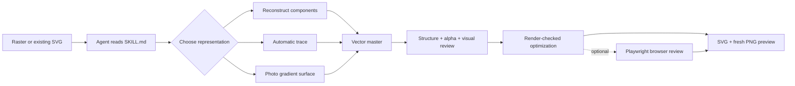

# Raster to SVG

A portable AI agent skill for turning raster artwork into editable SVG while
preserving the source design. Includes reconstruction guidance, local tracing and
shading helpers, structural validation, rendered previews, and conservative SVG
optimization. **MIT licensed**, with separately licensed third-party dependencies.

Works with **Claude Code, Gemini CLI, Codex**, and other agents that can read the
open [Agent Skills format](https://agentskills.io/specification) and execute local
Python/Node commands. No provider API, account key, MCP server, or model SDK is
required by the conversion helpers. The agent itself still needs its normal model
access. Browser verification with **Playwright is optional**.

> This is a workflow and toolkit, not a promise of one-click professional redraws.
> Clean logo reconstruction requires source-guided agent work and visual review.
> Dense traces and photographic surfaces can be large and hard to edit.

## What is included

- Artist-quality reconstruction guidance for original lettering, smooth contours,
  meaningful component groups, and source-matched lighting.
- Inkvec 0.2.6 gradient-aware tracing; a Windows x64 executable with its upstream
  license and notices is included. macOS/Linux use the upstream CLI separately.
- Portable VTracer WebAssembly tracing, with orientation/color normalization and
  previews through Sharp/librsvg.
- Python helpers for angular and curved masks, fitted gradients, locked component
  geometry, curved tonal regions, and adaptive photographic gradient surfaces.
- Strict structural checks and raw-alpha inspection at multiple sizes.
- Optimization that retains the master and accepts a smaller SVG only when raw
  RGBA renders match exactly at the tested sizes.
- An optional `playwright-svg-verification` companion skill for real Chromium
  screenshots on white and black at 50%, 100%, and 200%.



See **[architecture and diagrams](docs/architecture.md)** for module boundaries,
data flow, algorithm choices, and the limits of each verification layer.

## Requirements

| Dependency | Used for | Installation |
| --- | --- | --- |
| Python 3.12+ with pip/venv | Numerical helpers, validator, optimizer | Install Python separately |
| Node.js 22+ with npm | Tracing, rendering, comparison | Install Node separately |
| NumPy, Pillow, SciPy, headless OpenCV, ContourPy | Masks, curves, gradients, photo surfaces | Pinned in `requirements.txt` |
| Sharp 0.35.5 and VTracer 1.0.0-alpha.4 | Core rendering and automatic trace | Pinned in `scripts/package-lock.json` |
| Inkvec 0.2.6 | Optional preferred gradient-aware trace | Bundled Windows x64; separate upstream CLI elsewhere |
| Playwright 1.64.1 + Chromium | Optional real-browser verification | Separate pinned npm package; opt-in setup |
| Vector editor | Optional import/editability testing | Install the requested editor separately |

Core dependencies install from PyPI/npm. Playwright downloads its browser only
when selected. Conversion and verification run locally after setup. Python direct
dependencies are pinned; `requirements.txt` is not a hash-locked transitive Python
environment. npm lockfiles include dependency integrity hashes.

## Quick start

Clone the repository into a writable directory:

```sh
git clone https://github.com/light691/raster-to-svg.git
cd raster-to-svg
python scripts/setup.py
```

On macOS/Linux, use `python3` for the initial command if `python` is unavailable.
Setup creates `.venv` and installs Node packages beside the helpers. It does not
change system Python packages or install an agent. Activate the environment:

```powershell
# Windows PowerShell
.\.venv\Scripts\Activate.ps1
python scripts/doctor.py
```

```sh
# macOS / Linux
. .venv/bin/activate
python scripts/doctor.py
```

If PowerShell activation is restricted, call `.venv\Scripts\python.exe` directly;
you do not need to change your execution policy. For example:

```powershell
.\.venv\Scripts\python.exe scripts/doctor.py
```

Try a local automatic trace (paths below are relative to the repository root):

```sh
node scripts/vectorize.cjs --input /path/to/source.png --output work/master.svg --mode import --preset compact --preview work/master.png
python scripts/verify_svg.py work/master.svg --strict
python scripts/optimize_svg.py work/master.svg --output work/artwork.svg --work-dir work/optimization --preview work/artwork.png --report work/optimization.json
```

For gradient-aware tracing when Inkvec is available:

```sh
python scripts/inkvec.py /path/to/source.png -o work/inkvec.svg --mode quality
python scripts/verify_svg.py work/inkvec.svg --strict
```

Create the output parent directory first when invoking Inkvec directly. For a
professional logo master, ask the agent to use the reconstruction route instead
of assuming these automatic commands are sufficient.

## Install into your agent

The entire directory containing `SKILL.md`, `scripts/`, and `references/` is the
skill. Copying only `SKILL.md` loses the helpers. Our installer copies the bundle,
excludes installed dependencies, and **refuses to overwrite an existing skill**.
Run setup in the installed copy; virtual environments are not portable.

| Agent | Personal discovery location | Project discovery location |
| --- | --- | --- |
| Claude Code | `~/.claude/skills/raster-to-svg/` | `.claude/skills/raster-to-svg/` |
| Gemini CLI | `~/.gemini/skills/raster-to-svg/` | `.gemini/skills/raster-to-svg/` |
| Codex | `~/.agents/skills/raster-to-svg/` | `.agents/skills/raster-to-svg/` |
| Other Agent Skills hosts | Use the host's documented path | Or load this `SKILL.md` explicitly |

These paths follow the official [Claude Code](https://code.claude.com/docs/en/skills),
[Gemini CLI](https://geminicli.com/docs/cli/skills/), and
[Codex](https://learn.chatgpt.com/docs/build-skills) documentation. Gemini also
supports the shared `.agents/skills` alias. Installation compatibility is based
on the documented format and discovery paths; model behavior across these agents
has not been independently benchmarked.

```sh
# Choose ONE agent. The command prints the installed path and next setup step.
python scripts/install_skill.py --agent claude
python scripts/install_skill.py --agent gemini
python scripts/install_skill.py --agent codex
```

For a project installation, or a shared/other host path:

```sh
python scripts/install_skill.py --agent claude --scope project --project-dir /path/to/project
python scripts/install_skill.py --agent agents --scope project --project-dir /path/to/project
python scripts/install_skill.py --destination /path/to/agent/skills --dry-run
```

Run `python /installed/path/raster-to-svg/scripts/setup.py`, activate the installed
`.venv`, then restart or refresh your agent. Gemini CLI also supports
`gemini skills install https://github.com/light691/raster-to-svg.git`; dependency
setup is still a separate step. Some hosts may discover the optional nested skill
too; its browser packages remain opt-in.

Example prompts:

```text
Claude Code: /raster-to-svg Convert this logo to an editable SVG. Preserve its
lettering and layout, rebuild clean curves, and deliver the SVG plus PNG preview.

Gemini CLI: Use the raster-to-svg skill to convert this artwork to an editable SVG.
Preserve its original design and inspect the rendered result.

Codex: Use $raster-to-svg to reconstruct this logo as a clean vector master.
```

For an agent without skill discovery, give it the local path to `SKILL.md` and ask
it to read the linked references as needed. It needs file/image inspection and
process execution capabilities; a text-only chat cannot execute these helpers.

## Optional Playwright verification skill

```sh
# In the cloned repository: opt in to Playwright packages + Chromium.
python scripts/setup.py --playwright
python scripts/doctor.py --playwright
node optional-skills/playwright-svg-verification/scripts/verify_browser.cjs --input work/artwork.svg --output-dir work/browser-qa

# Install both skill entrypoints into your chosen agent's discovery directory.
python scripts/install_skill.py --agent claude --with-playwright
```

For that last command, set up the **installed core copy** with `--playwright` too.
The companion's dependencies are located inside that copy; the sibling companion
entrypoint automatically reuses that optional runtime when its own packages are
absent. It can also be set up independently as described in its `SKILL.md`.
See [the complete browser verification guide](docs/browser-verification.md),
including Linux system libraries, screenshot review, and editor-testing limits.

## Available helpers

| Helper | Role |
| --- | --- |
| `scripts/setup.py` / `doctor.py` | Local setup and dependency diagnosis |
| `scripts/install_skill.py` | Agent discovery-directory installer |
| `scripts/inkvec.py` | Portable Inkvec executable resolution |
| `scripts/vectorize.cjs` | VTracer trace, preview, and comparison report |
| `scripts/verify_svg.py` | Standalone SVG structure check; `--strict` for full vector |
| `scripts/preview_svg.cjs` | Sharp rendering and raw-alpha checks |
| `scripts/optimize_svg.py` | Conservative candidates and exact RGBA acceptance gate |
| `scripts/compare_svg.cjs` | Optimizer's internal multi-size renderer |
| `scripts/clean_mask.py` / `fit_curves.py` | Angular/cubic contours from isolated masks |
| `scripts/component_bundle.py` | Lock, assemble, and audit accepted component geometry |
| `scripts/fit_gradient.py` / `vector_tones.py` | Source-sampled material shading |
| `scripts/compare_profiles.py` | Source-space color sections and diagnostic luminance charts |
| `scripts/photo_to_svg.py` | Adaptive gradient surface for opaque photographs |

Each executable exposes `--help` except the internal `compare_svg.cjs` renderer,
which consumes an optimizer manifest. Detailed workflow references live in
[`references/`](references/).

## Verification and limitations

Structure, visual fidelity, editability, and editor import are separate judgments.
The strict validator rejects embedded images, active content, external resources,
filters, masks, and live text; it does not prove the artwork looks good. Outlined
lettering remains editable geometry, not editable font text.

The optimizer proves render equality **only at the tested sizes in the tested
renderer**. Browser screenshots require visual inspection. Neither establishes
Illustrator/Inkscape import until that editor is actually checked. Photographic
surfaces approximate texture and can contain many thousands of shapes.

Run the repository's deterministic smoke checks:

```sh
python tests/smoke.py
python tests/smoke.py --playwright
```

CI runs the core checks on Windows, macOS, and Linux and browser checks on Linux.
See [contributing](CONTRIBUTING.md) for what those checks establish and how to
report a visual regression. See [third-party notices](THIRD_PARTY_NOTICES.md) for
dependency licenses, bundled binary provenance, and upstream links.

## Troubleshooting

- **Missing Python module:** activate this copy's `.venv`, or use its Python by
  absolute path. `doctor.py` checks the interpreter actually running it.
- **Sharp cannot load:** use a supported Node 22+ build and run `npm ci --prefix
  scripts` on the target OS. Do not copy another platform's `node_modules`.
- **Inkvec unavailable:** install the upstream CLI or use VTracer. This is an
  optional doctor warning and does not prevent core tracing/validation.
- **Playwright executable missing:** run setup with `--playwright` in the copy
  whose browser helper you are using. On Linux, see the system-dependency guide.
- **Large SVGs:** choose an appropriate representation. Simplification and
  texture reduction change the image and cannot be called lossless optimization.
- **Skill not discovered:** check the folder name/location, refresh the agent,
  and confirm it can read the whole bundle. Do not install duplicate copies into
  multiple precedence paths unless you intend that behavior.
