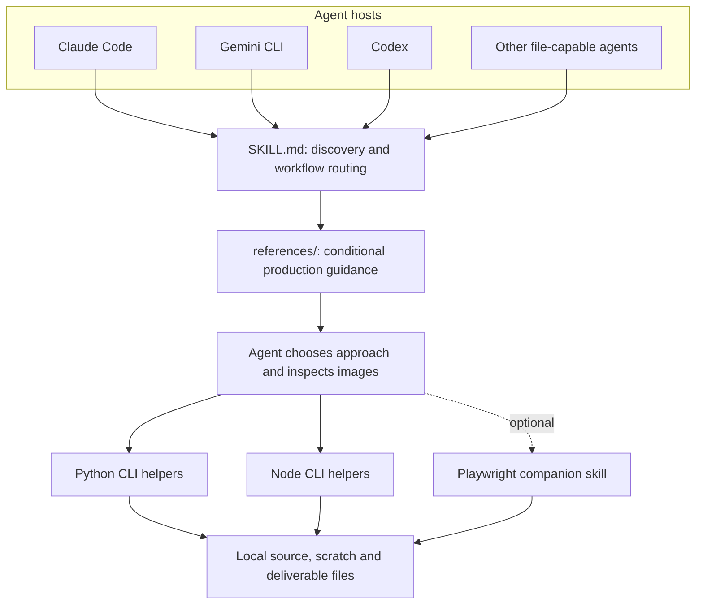
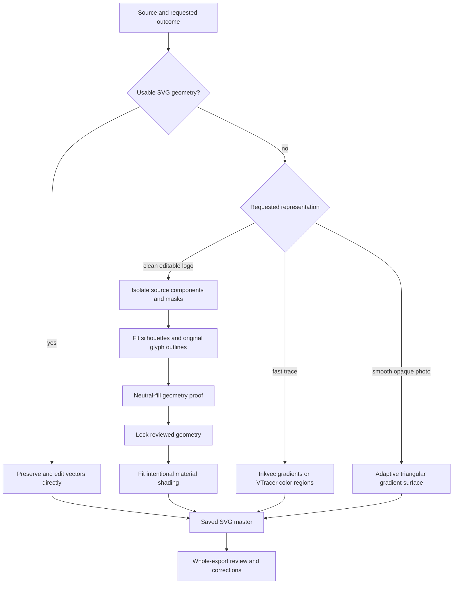
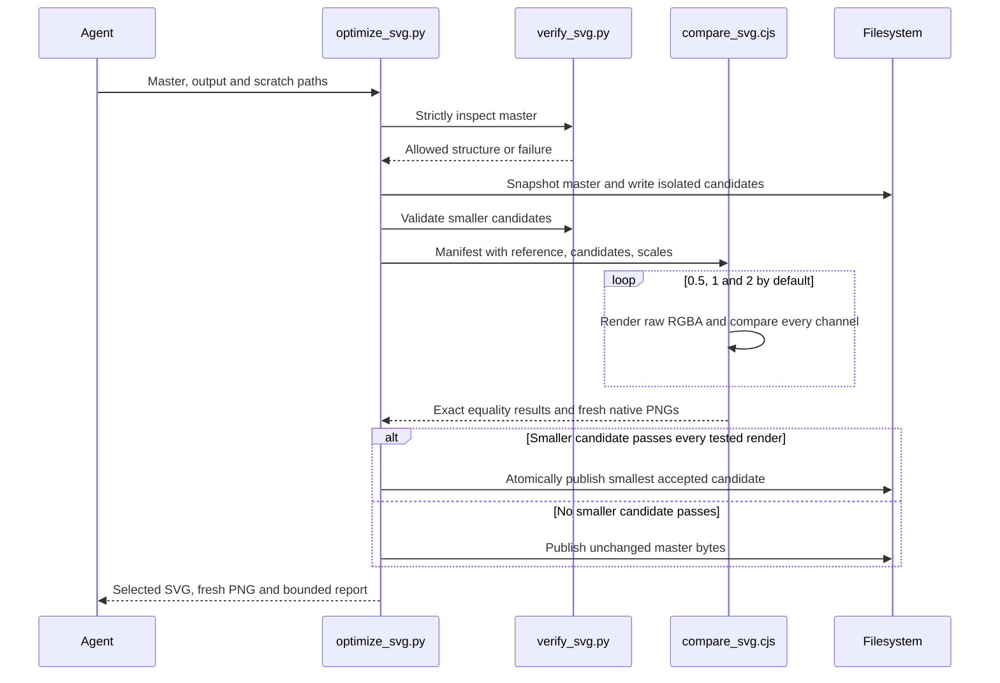
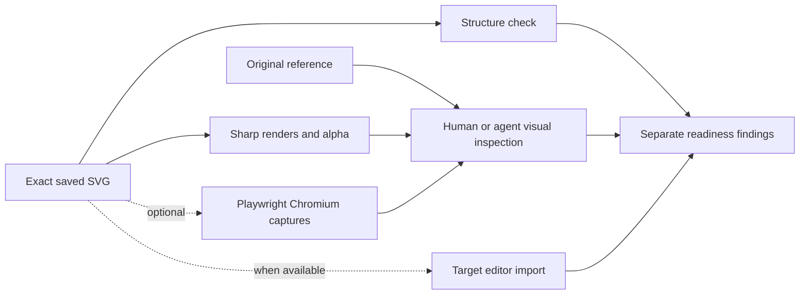

# Architecture

This repository separates agent decisions from deterministic local helpers.
The agent interprets the requested quality and inspects the reference. The
helpers generate, assemble, render, or validate files. There is no service,
database, telemetry process, model API client, or required MCP server.

## Agent integration

`name` and `description` in YAML frontmatter support skill discovery. The body
routes to references only when relevant. All commands resolve paths relative to
the skill directory; there are no hard-coded user home paths. `agents/openai.yaml`
is optional Codex UI metadata. Other hosts can ignore it.

`scripts/install_skill.py` copies the bundle into a host's discovery location.
Dependencies install in that copy with `scripts/setup.py`: Python packages in
`.venv`, Node packages beside each script. The installer does not overwrite a
pre-existing destination, modify agent settings, or copy another OS's runtime.

## Choose the representation before the engine

Reconstruction and automatic tracing solve different representation problems.
An automatic trace can retain raster texture in many tiny islands. A reconstruction
aims for source-faithful shapes, original glyph geometry, meaningful groups, and
manageable shading. A photo surface trades some fine texture for continuous
gradients and can still be dense. Engine settings alone cannot decide which
representation meets the user's request.

## Module and dependency map

| Module | Inputs | Outputs | Runtime/dependencies |
| --- | --- | --- | --- |
| `inkvec.py` | Raster plus forwarded CLI flags | Upstream Inkvec SVG | Python stdlib + external/bundled Inkvec |
| `vectorize.cjs` | Raster or deliberately rendered SVG | Trace, PNG, JSON metrics | Node, VTracer WASM, Sharp |
| `clean_mask.py` | Isolated black-on-white mask | Angular fitted outlines | NumPy, Pillow, OpenCV |
| `fit_curves.py` | Mask and optional corner guides | Cubic contour outlines | NumPy, Pillow, OpenCV, SciPy |
| `component_bundle.py` | Component SVGs, manifest, optional paint JSON | Geometry lock, assembled master, audit | Python stdlib, `verify_svg.py` |
| `fit_gradient.py` | Reference raster + material mask | Linear/radial paint JSON, fit report | NumPy, Pillow, OpenCV, SciPy |
| `vector_tones.py` | Reference, mask, accepted outline | Clipped curved tonal SVG, report | Numerical stack + ContourPy, sibling helpers |
| `compare_profiles.py` | Same-canvas reference/candidate PNGs and section guides | Color profiles, section overlays, JSON samples | NumPy, Pillow |
| `photo_to_svg.py` | Opaque raster | Gradient mesh SVG, report | NumPy, Pillow, OpenCV, SciPy |
| `verify_svg.py` | SVG file | Structure-only JSON result and exit code | Python stdlib |
| `preview_svg.cjs` | Standalone SVG | PNG, optional matte previews, alpha report | Node, Sharp/librsvg |
| `optimize_svg.py` | Strict-valid master | Selected SVG, PNG, optional SVGZ, report | Python stdlib, verifier, Node renderer |
| `compare_svg.cjs` | Internal candidate manifest | Raw-RGBA comparison report | Node, Sharp/librsvg |
| Optional `verify_browser.cjs` | Saved SVG | Chromium screenshots, report | Playwright/Chromium + Python verifier |

### Tracing and shading internals

**VTracer:** Sharp decodes the input, applies EXIF orientation, normalizes sRGB and
alpha, then hands PNG bytes to the WASM tracer. The helper chooses detail/compact
engine settings, restores source display dimensions through a viewBox, and checks
the returned vector structure. `import` mode uses ordinary geometry; `fidelity`
mode can use an SVG coverage filter and is unsuitable for strict filter-free
delivery. Comparison metrics describe raster error, not design quality.

**Inkvec:** the launcher resolves `INKVEC_BIN`, PATH, then the bundled Windows x64
CLI. Inkvec provides native transparency and gradient-aware tracing. Preserve its
viewBox, including a nonzero origin. Other operating systems install the upstream
CLI; this project does not rebuild or modify the included binary.

**Component reconstruction:** masks represent individual physical objects, not
just colors. Angular fitting preserves straight stems and corners; cubic fitting
targets curved forms. The bundle helper locks accepted geometry and drawing
order, then clips source-space paints inside those outlines. Geometry integrity
does not prove that the original segmentation was faithful.

**Gradient fitting:** samples within a reviewed material mask support linear and
elliptical radial models. Held-out pixel error helps choose a model. More complex
connected materials can use ContourPy level sets and cubic tonal boundaries.
Their complexity and actual enlarged appearance still need review.

**Photo surfaces:** mild edge-preserving smoothing feeds an adaptive triangulation.
Shared vertices and linear gradients approximate color; a second translucent
gradient can account for local hue variation. Internal triangles use a targeted
coverage hint to reduce cracks. Alpha and browser checks remain necessary because
renderers can differ. Transparency is rejected instead of silently flattened.

## Optimization acceptance gate

Candidate transformations compact exact numeric spelling, prune unreachable
definitions, inherit redundant gradient attributes, shorten internal resource IDs,
and share identical unnamed shading groups. They do not round coordinates,
simplify silhouettes, merge nearby colors, or retrace the result.

Native scale is always included. Missing renderer dependencies or invalid input
fail the pass; an unverified optimization is not published. A changed master is
detected before publication. Render identity is a finite observation in one
renderer, not proof of equivalence in every editor or zoom level. The accepted
geometry audit precedes optimization, because equivalent SVG syntax can differ
from the conservative lock representation.

## Verification layers

| Layer | Establishes | Does not establish |
| --- | --- | --- |
| Strict XML inspection | Allowed elements and local resources; vector geometry exists | A complete security sandbox, source fidelity, good contours |
| Raw-alpha inspection | Actual coverage at tested sizes before compositing | Whether transparency is artistically intended |
| Exact RGBA comparison | Render equality for accepted optimization at tested scales | All-renderer equivalence or improved source quality |
| Playwright capture | Real Chromium loading, dimensions, screenshot artifacts | Automatic aesthetic approval or all-browser compatibility |
| Visual review | Observed source differences and defects in inspected regions | Unseen areas or recovered missing source detail |
| Target editor test | Observed import, appearance and editing in that version | Behavior in every other editor/version |

The optional companion uses an `` wrapper around an SVG data URL, avoids
expanding dense artwork into the page DOM, and blocks network requests. It runs
the core structural guard before browser loading. Screenshots are taken at CSS
sizes with device scale factor 1. Oversized captures are capped and marked as
cropped so they cannot be mistaken for whole-art review. Browser loading is not
editor import testing.

## Files, trust and extension points

Keep original references and intermediate candidates in a writable scratch
directory; deliver the selected SVG and a preview rendered from that exact file.
Geometry locks, paint manifests, alpha reports and optimizer manifests are local
interchange files, not a persistent project database. Helpers do not upload images
or contact model services. Installation downloads packages/browsers, while the
host agent may independently use its configured model or tools.

These tools are intended for locally supplied artwork. Structural inspection is
conservative workflow validation, not a hardened sandbox for arbitrary hostile
inputs. Resource size limits exist in rendering helpers; large source images and
meshes can still require substantial memory.

To add an engine, preserve the source canvas and useful groups, route it from the
skill, and run the common strict validation/preview/optimization workflow. To add
a shading model, test representative silhouettes, holes and contacts before
repeating it across an illustration. To add a renderer, retain the renderer name,
version and scale evidence instead of merging its result into an unconditional
"valid artwork" flag.
